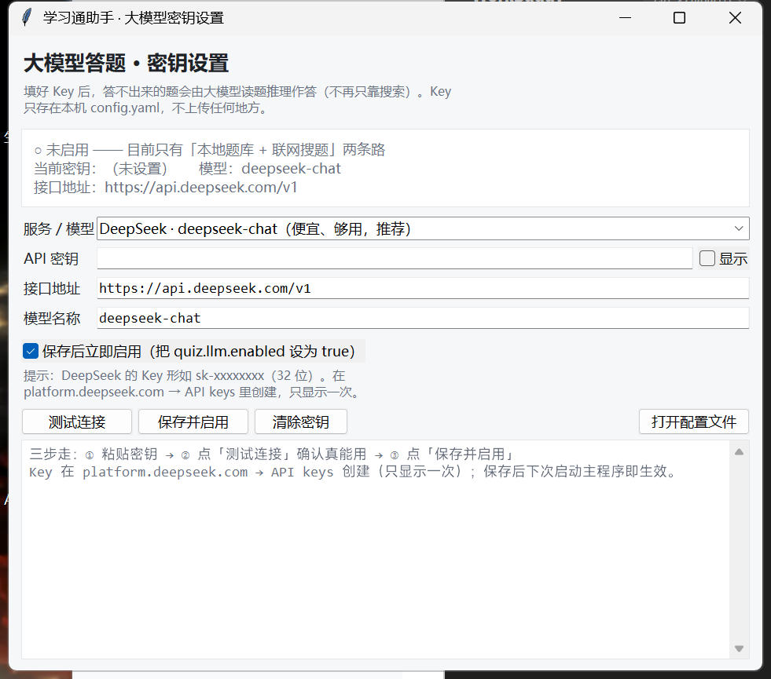

# 学习通自动化助手（chaoxing-auto-study）

> 用 **真实浏览器**（Playwright 驱动本机 Edge）完成学习通/超星课程的视频、音频、课件、章节测验，
> 带**字体混淆解码**、**选项顺序对齐**、**题库→大模型→双源搜题→兜底推理**四级答题链路，
> 以及**环境自检 / 密钥图形设置 / 密钥扫描**等工程化配套。

当前版本：**v1.0.0**（2026-10-28）｜平台：Windows 10/11（另有 macOS/Linux 的 `.sh` 脚本）｜许可：GPL-3.0

---

## 一、它解决什么问题

学习通（超星）的课程任务点主要有四类：**微课视频、音频导学、课件/文档、章节测验**。
其中真正难的不是"点播放"，而是这三件事：

1. **视频必须真实看完**：平台按真实时间核验，倍速、改系统时钟、并发多开都会被判无效
   （本项目实测：1x 播完 → 登记成功；2x 播完 → 三次复核仍未登记）。
2. **章节测验的题面被加密字体混淆**：网页里 `环境保护法` 显示成 `环糵保护孾`，
   直接复制去搜永远搜不到。
3. **不同网站给的答案字母对不上**：源站"答案 B"指的是它的 B，你的页面选项顺序可能完全不同，
   盲信字母是选择题大量答错的头号元凶。

本项目的核心工作量就在这三点上，其余是工程配套。

## 二、功能特性

| 模块 | 能力 |
|---|---|
| 登录与会话 | 扫码 / 手机号密码；登录态持久化；**掉线自愈**（探测 + 自动重登 + 断网退避限频） |
| 任务点识别 | 按平台接口判定（`myjobsnodesmap`）已完成 / 待完成 / 无任务点，**不靠会滞后的页面标记** |
| 视频 | 真实 1x 播放、进度轮询、卡顿自愈、播放完成后再用接口 + 延迟复核确认登记 |
| 音频 | 音频导学走同一套播放器逻辑（video.js + `modules/audio`），按真实时长播完 |
| 文档 | 翻页/滚动浏览，单页正文自动识别（不会傻等 15 分钟） |
| 章节测验 | 加密字体解码 → 题库 → 大模型 → 双源搜题 → 兜底推理；单选/多选/判断/填空分别处理；提交后回读结果沉淀题库 |
| 答题可靠性 | 选项文本对齐、双源交叉核对与冲突仲裁、多选题补全、判断题必答、**任何情况不留空**（留空会触发平台"还有 X 道题未作答"拦截） |
| 反风控 | 贝塞尔鼠标轨迹、随机延时、随机滚动、长暂停、频率限制、遇风控页可暂停等人工 |
| 可观测 | 逐任务点日志、完成报告（Markdown + JSON）、日志自动脱敏（Key/手机号） |
| 工程化 | 环境自检 `doctor`、密钥图形设置、提交前密钥扫描、9 组离线测试、一键打包 |

## 三、与同类项目的对比

调研时间 2026-10，样本为 GitHub 上活跃度较高的几个方向：

| 项目 | 技术路线 | 答题方案 | 部署 | 许可 |
|---|---|---|---|---|
| **SuperAutoStudy**（多家 fork） | Spring Boot + Dubbo + RabbitMQ + Redis，直接调学习通官方 API + 时间欺骗 | 自建"Super 题库"百万级 + 可挂多个第三方题库 token | Docker / JVM，需中间件 | Apache-2.0 |
| **QIZHENG qizhen-auto-learner** | Python + GUI | 本地 AI 模型 + OCR + 视觉检测答题弹窗 | 本机 Windows，需装模型/OCR | 未标注 |
| **MaaBlock/chaoxing** | Maa 框架（图像识别自动化） | provider 链：言溪 / GO题 / tikuAdapter / AI / 硅基流动，带 `cover_rate` 覆盖率门槛 | 本机 | 未标注 |
| **tikuAdapter**（题库聚合中间件） | Go 单文件服务 | 把 10+ 题库聚合成一个标准 HTTP 接口 | 自建服务 | 开源 |
| 各类油猴脚本 / selenium 脚本 | 浏览器脚本 | 多为单一题库或手填 | 浏览器内 | 各异 |
| **本项目** | Python + Playwright 驱动**本机真实 Edge** | 本地题库 → 第三方题库（icodef/言溪/tikuAdapter）→ OpenAI 兼容大模型 → 双源搜题 → 兜底推理 | 本机 Windows，零中间件 | GPL-3.0 |

### 我们的优点

1. **不伪造 API 请求**：走真实浏览器、真实点击、真实播放，只做"人已经做过的事"，不构造平台接口载荷，
   减少因接口字段/风控策略变动导致的整片失效。
2. **字体混淆解码**：内置 30884 条字形哈希表，能把被 `cxSecretStyle` 混淆的题面还原成正常中文——
   这是很多脚本直接放弃的一类课程。
3. **答案可靠性做得深**：选项文本对齐（免疫选项顺序差异）、双源交叉核对 + 冲突仲裁、
   多选题补全、判断题必答、**禁止留空**。实测同一门课同一套题：旧逻辑 10~20 分，新逻辑 80 分。
4. **离线也能跑**：没有题库 token、没有大模型 Key 也能工作（搜题 + 兜底推理），
   不会像纯题库方案那样"没 token 就完全不动"。
5. **可解释**：每题都会在日志里写清来源与置信度（`题库(icodef)` / `双源一致` / `兜底推理(置信0.28)`），
   出错能复盘，而不是黑盒。
6. **工程化配套**：环境自检、密钥图形界面、提交前密钥扫描、离线测试集、一键打包。
7. **零中间件**：不需要 Docker/RabbitMQ/Redis，解压 + `setup.bat` 即可。

### 我们的缺点（客观）

1. **慢**：视频/音频必须真实时长播放，一门 40 个任务点的课要跑几小时。号称"秒刷完"的方案基本都在
   利用平台漏洞或伪造请求，代价是随时集体失效。
2. **不能并发多账号**，也没有服务端调度（SuperAutoStudy 的强项）。
3. **仅 Windows 脚本**：核心逻辑是跨平台的 Python，但 `.bat` 入口只做了 Windows。
4. **题库能力依赖外部 token**：icodef / 言溪 需要自己去领免费 token；不想注册就只能靠搜题。
5. **不覆盖考试与作业自动作答**（作业只做占位提交，考试一律人工）。
6. **反检测是"拟人化"级别**，不是专业指纹伪装；高频长时间跑仍有被风控的可能。
7. **无内置 UI 主界面**（只有密钥设置是 GUI），日常靠命令行菜单。

### 据此做的改进（v1.0.0 已落地）

| 对比发现的差距 | 本次改进 |
|---|---|
| 同类普遍接第三方题库 API，命中率远高于网页搜索 | 新增 `cxlab/tiku.py`：支持 **icodef / 言溪 / tikuAdapter / 自定义** 四类 provider，按顺序回退、命中即止、连续失败 3 次熔断；命中答案计入可信等级 `tiku` |
| 同类有 `cover_rate` 覆盖率门槛才提交 | 已有"禁止留空"：搜不到 → 兜底推理给带置信度的判断，**不会因空题导致提交被平台拦截** |
| 同类提供 GUI / 一键安装 | 新增 `setup.bat` 全自动安装、`start.bat` 菜单、`tools/set_key_gui.py` 密钥图形界面（含**余额查询**） |
| 同类有部署文档 / 版本管理 | 新增 `tools/doctor.py` 环境自检、`--version`、`VERSION`、`CHANGELOG.md`、CI |
| 隐私风险（Key/Cookie 误上传） | 新增 `.gitignore` 白名单式排除 + `tools/check_secrets.py` + **pre-commit 钩子**双重拦截；日志自动脱敏 |
| 无分发形态 | 新增 `tools/package.py` 白名单打包，产物 `dist/chaoxing-auto-study-v1.0.0.zip` |

## 四、安装

### 环境要求

| 项 | 要求 | 说明 |
|---|---|---|
| 操作系统 | Windows 10 / 11（64 位） | 入口脚本为 `.bat`；Python 代码本身跨平台 |
| Python | **3.10+**（实测 3.13.14） | 安装时勾选 `Add python.exe to PATH` |
| 非 Windows | macOS / Linux / WSL 可用 `./setup.sh` + `./start.sh` | 需 `python3 -m playwright install chromium` |
| 浏览器 | Microsoft Edge（系统自带）或 Chrome | 程序**不下载** playwright 自带浏览器，直接用本机已装的 |
| 磁盘 | ≥ 200 MB | 主要占用是 `.venv` 与字形表（1.6 MB） |
| 网络 | 能访问学习通、PyPI | 国内建议保留清华镜像（`setup.bat` 已内置） |

依赖版本（`requirements.txt`）：

```
playwright>=1.40      # 浏览器自动化（用系统 Edge，无需 playwright install）
PyYAML>=6.0           # 配置
fonttools>=4.60       # 解析加密字体（题面还原）
```

### 安装步骤

```bat
:: 1. 解压后进入目录
:: 2. 双击 setup.bat（自动：建 .venv → 装依赖 → 生成 config.yaml → 环境自检）
:: 3. 双击 start.bat
```

`setup.bat` 会依次做四件事，并在最后跑一次 `tools/doctor.py` 自检：

```
[1/4] 已找到 Python 3.13.14
[2/4] 创建虚拟环境 .venv ...
[3/4] 安装依赖（清华镜像，失败自动回退官方源）
[4/4] 已根据 config.example.yaml 生成 config.yaml
✔ 环境可用（2 项建议项可忽略）。下一步：双击 start.bat
```

## 五、使用

### 图形菜单（推荐）

双击 `start.bat`（桌面快捷方式同理）：

```
============================================================
               学习通自动化助手  v1.0.0
============================================================
   大模型答题：[已启用] deepseek-flash  sk-e98***2099
------------------------------------------------------------
   [1] 试运行      ：只扫描章节和任务点，不真正学习
   [2] 正式运行    ：自动学习（已完成的任务点自动跳过）
   [3] 只刷视频/音频
   [4] 只做测验
   [5] 选择课程与课时：字母多选课程 → 选课时范围 → 确认
   [6] 列出我的课程（含课程编号）
   [7] 打开报告目录
   [8] 编辑配置
   [9] 清除登录态
   [K] 设置大模型密钥（DeepSeek / Kimi / 本地 Ollama）
   [T] 配置第三方题库（icodef / 言溪 / tikuAdapter）
   [D] 环境自检
   [0] 退出
```

**建议顺序**：`[1] 试运行` 看清单对不对 → `[K]` 配密钥/题库（可选）→ `[2] 正式运行`。

也可以带参数直达，便于做多个快捷方式：

```bat
start.bat run      :: 正式运行
start.bat quiz     :: 只做测验
start.bat video    :: 只刷视频/音频
start.bat pick     :: 交互选课程与课时
start.bat doctor   :: 环境自检
start.bat key      :: 密钥设置
start.bat tiku     :: 题库配置
```

### 命令行

```bat
.venv\Scripts\python.exe main.py --version
.venv\Scripts\python.exe main.py --config config.yaml --dry-run
.venv\Scripts\python.exe main.py --config config.yaml
.venv\Scripts\python.exe main.py --config config.yaml --select "某思政课" --only quiz
.venv\Scripts\python.exe main.py --config config.yaml --lessons "1-5,8"
.venv\Scripts\python.exe main.py --config config.yaml --list-courses
```

| 参数 | 作用 |
|---|---|
| `--dry-run` | 只扫描章节/任务点结构，不实际学习 |
| `--select` | 指定课程（名称关键词或 courseId），逗号分隔可多选，`all` 表示全部 |
| `--only {video,document,quiz}` | 只处理某类任务点 |
| `--lessons "1-5,8"` | 只学指定课时序号；也支持 `"课程名=1-3;另一门=2,4"` |
| `--pick` | 交互：字母多选课程 → 选课时范围 → 确认执行 |
| `--headless` | 无界面运行（扫码/验证码场景别用） |

### 配置密钥（可选）



双击菜单里的 `[K]`，或

```bat
.venv\Scripts\python.exe tools\set_key_gui.py            :: 图形界面
.venv\Scripts\python.exe tools\set_key_gui.py --balance  :: 只查余额（免费，不耗 token）
.venv\Scripts\python.exe tools\set_key_gui.py --test     :: 先查余额再发一次最小请求
.venv\Scripts\python.exe tools\set_key_gui.py --set-key sk-你的密钥
```

> 注意：DeepSeek 已下线 `deepseek-chat`，现在请用 `deepseek-flash`（默认）或 `deepseek-v4-pro`。
> 界面里选预设会自动填好地址与模型名。

### 接第三方题库（推荐，准确率提升明显）

双击菜单 `[T]`（或 `SetTiku.bat`）打开设置窗口：勾选题库 → 填 token/地址 → 测试连通性 → 保存。
也可以直接改 `config.yaml`（`icodef` / 言溪 都能免费领 token）：

```yaml
quiz:
  tiku:
    enabled: true
    timeout_s: 12
    providers:
      - type: icodef          # GO题/网课小工具
        token: "你的 token"
      - type: enncy           # 言溪题库
        token: "你的 token"
      - type: tikuadapter     # 自建聚合服务（可选）
        url: "http://127.0.0.1:8060"
```

多个 provider 按顺序尝试，命中即止；某个连续失败 3 次会自动熔断，不影响其它 provider。

## 六、答题链路

```
                   ┌──────────────────────────────┐
  章节测验页面 ──▶ │ ① 加密字体解码（30884 字形表）│──▶ 正常中文题面
                   └──────────────────────────────┘
                                 │
                                 ▼
        ┌────────────── 逐题作答（命中即止）──────────────┐
        │ ② 本地题库（你自己沉淀的答案，可信等级最高）      │
        │ ③ 第三方题库 API（icodef / 言溪 / tikuAdapter）   │
        │ ④ 大模型推理（OpenAI 兼容，带置信度门槛）         │
        │ ⑤ 双源联网搜题（通用搜索 + 作业帮，交叉核对）      │
        │ ⑥ 兜底推理（搜不到也给带置信度的判断，不留空）     │
        └──────────────────────────────────────────────────┘
                                 │
                                 ▼
        选项文本对齐 → 点击选项 → 读隐藏域自检 → 提交
                                 │
                                 ▼
        结果页回读正确答案 → 沉淀进 data/question_pool.json（下次直接用）
```

**为什么"不留空"很重要**：留空不只是本题 0 分，学习通会弹"还有 X 道题未作答"直接**拦截提交**，
整份测验白做（本项目曾因此在 6.4 本章自测上整份失败）。

## 七、项目结构

```
chaoxing-auto-study/
├─ main.py                  # CLI 入口
├─ start.bat / setup.bat    # 菜单 / 一键安装
├─ SetDeepSeekKey.bat       # 密钥设置入口
├─ config.example.yaml      # 全量注释示例配置
├─ cxlab/                   # 核心包
│  ├─ browser.py            # 浏览器与上下文
│  ├─ login.py              # 登录 / 会话守护 / 掉线自愈
│  ├─ course.py             # 课程列表、状态判定、课时选择
│  ├─ runner.py             # 章节遍历与任务点调度（核心循环）
│  ├─ video.py              # 视频/音频播放与进度
│  ├─ document.py           # 课件浏览
│  ├─ quiz.py               # 测验作答、选项填充、提交与复核
│  ├─ font_decoder.py       # 加密字体还原
│  ├─ online_answer.py      # 双源搜题 + 答案解析 + 选项对齐
│  ├─ tiku.py               # 第三方题库接口（v1.0.0 新增）
│  ├─ reasoning.py          # 本地推理与兜底作答
│  ├─ llm_answer.py         # 大模型答题（含熔断）
│  ├─ answers.py            # 本地题库与可信等级
│  ├─ report.py / logutil.py / humanize.py / popups.py
├─ tools/                   # doctor / set_key_gui / check_secrets / package / monitor …
├─ tests/                   # 9 组离线测试（不联网、不碰学习通）
├─ data/                    # 字形表 + 题库（题库默认不进仓库）
└─ docs/                    # 架构说明 + 开发日志
```

## 八、常见问题

| 现象 | 处理 |
|---|---|
| `setup.bat` 报找不到 Python | 装 Python 3.10+，勾选 `Add python.exe to PATH` |
| 双击后黑窗口一闪而过 | 命令行里运行 `start.bat` 看报错；或跑 `tools\doctor.py` |
| 视频播完但平台不算完成 | 平台按真实时间核验，请确保 1x 速、窗口不最小化、网络不断；程序会自动延迟复核 |
| 测验提交失败提示"还有题目未作答" | v1.0.0 已默认不留空；若仍出现，把 `quiz.on_unknown` 改成 `submit_blank` 并贴日志反馈 |
| 中文显示乱码 | `.bat` 为 GBK(936) 编码，需系统区域支持简体中文 |
| 大模型报 402 | 用 `--balance` 查余额；余额为 0 或负数都不可用 |
| 大模型报 404 | 模型名过期（如 `deepseek-chat` 已下线），换成 `deepseek-flash` |

## 九、安全与隐私

- **API Key / 密码只存在本地 `config.yaml`**，该文件被 `.gitignore` 排除，永不入库；
- 仓库提供 `tools/check_secrets.py` + `.githooks/pre-commit`，提交前自动扫描
  **API Key / Cookie / 手机号 / 密码字段**，命中即阻止提交；
- 运行日志自动脱敏（`sk-****`、`1**********`、`password=****`）；
- 登录态 `state/storage_state.json`、题库 `data/question_pool.json`、报告 `output/` 一律不入库；
- 打包脚本 `tools/package.py` 采用**白名单**收集文件，私人数据不可能进包。

## 十、后续规划

1. **题库开箱向导**：在密钥界面里一并填题库 token，并做连通性自检；
2. **托盘/迷你 GUI**：把菜单搬进窗口，支持一键暂停、进度曲线；
3. **答案质量再上一档**：本地 embedding 语义匹配替代双字组覆盖率，减少"字面像但语义反"的误判；
4. **断点续跑与批量课程**：多课程排队 + 失败任务自动重排（已有 `retry_rounds`，继续增强）；
5. **跨平台**：`.sh` 入口 + Docker 镜像（无浏览器场景用 headless Chromium）；
6. **报告可视化**：按章节/题型统计正确率，输出可分享的 HTML 报告；
7. **风控灰度**：更细的操作间隔自适应、异常页面自动截图归档。

## 十一、免责声明

本项目仅用于**技术研究与个人学习效率**。使用者应遵守所在学校/机构的学术规范与平台用户协议，
不得用于代替本人完成必须本人完成的学习任务、不得用于作弊或批量代刷。使用产生的任何后果由使用者自负。

## 十二、致谢与许可

- 加密字体解码移植自 [Samueli924/chaoxing](https://github.com/Samueli924/chaoxing)（GPL-3.0），
  字形表 `data/font_map_table.json` 由其提供，本项目**同样以 GPL-3.0 发布**以保持许可兼容。
- 题库协议参考 [tikuAdapter](https://github.com/DokiDoki1103/tikuAdapter) 的开放接口格式。
- 鼠标轨迹移植自 ghost-cursor 的贝塞尔曲线思路。

**作者**：cxlab（项目代号）。完整许可证见 [LICENSE](LICENSE)；开发过程与实测数据见 [docs/DEVLOG.md](docs/DEVLOG.md)，
架构细节见 [docs/ARCHITECTURE.md](docs/ARCHITECTURE.md)。
